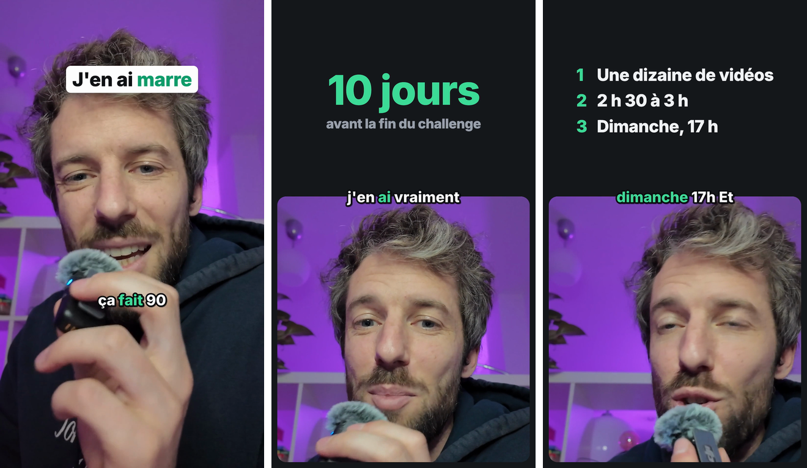

# my-claude-skills

Des skills Claude Code gratuites pour écrire, monter et publier tes vidéos face caméra (TikTok,
Reels, Shorts), auditer ton compte, et lire ta Search Console : une skill par tâche.

Pas d'application, pas de serveur, pas d'abonnement. Les skills disent à Claude comment
travailler, et leurs scripts tournent sur ton ordinateur : ffmpeg pour couper et rendre,
whisper.cpp pour le texte (gratuit, rien ne sort de ta machine), Remotion pour animer les titres
et les cartons si tu as Node. En option, une clé ElevenLabs pour une transcription plus fidèle, et
le connecteur Claude de [Nadia](https://usenadia.com) pour programmer tes posts. Je les utilise
pour mes propres vidéos et mes sites ; une nouvelle arrive chaque mardi avec
[ma newsletter](https://vincentventalon.com/newsletter).

## Commence ici

Trois étapes jusqu'à ta première vidéo montée :

1. **Installe** les skills (ci-dessous), puis ouvre Claude Code dans le dossier de ton projet.
2. **`/setup`** (ou « installe la skill vidéo ») : Claude regarde ce qui est installé sur ta
   machine, te fait choisir whisper ou ElevenLabs, pose ta langue et ton dossier de sortie, et
   installe ce qui manque une fois que tu as vu les commandes. Une fois.
3. Tourne une prise (téléphone, webcam, caméra), puis **`/edit`** : « monte ma vidéo, le rush est
   dans Téléchargements, titre : J'en ai *marre* ». Tu obtiens `~/Videos/edited/<nom>.mp4`, plus
   le texte, les sous-titres en `.srt` et l'état de la vidéo.

Tu ne sais pas quelle skill prendre ? **`/video <ce que tu veux>`** la choisit pour toi et reprend
la vidéo en cours au lieu de repartir de zéro.

## Ce que tu obtiens par défaut



*Trois images d'une vraie vidéo de 82 s, montée par `edit` depuis un rush de près de 6 min : le
hook, un carton chiffré, une liste.*

- **Les coupes** : les blancs, les faux départs et les reprises partent, ta dernière prise reste,
  et une coupe ne tombe jamais au milieu d'un mot.
- **Deux vues qui alternent** : le hook en plein cadre, ton titre posé dessus ; puis un split,
  un haut en aplat anthracite et toi dans une carte aux coins arrondis en bas. Elles changent
  toujours entre deux phrases, en visant 4 à 8 secondes par vue.
- **Des cartons sur le mot qui les dit** : un chiffre qui défile jusqu'à sa valeur, une liste
  numérotée, une phrase. Dis « mets des cartons » : Claude les propose à partir de ce que tu dis.
- **Les sous-titres** mot à mot, le mot dit en vert, sur la couture du split.
- **Un carton de fin** (« Abonne-toi pour la suite » dans ta langue), la voix à -14 LUFS, le
  volume des plateformes.
- **En 9:16** pour TikTok, Reels et Shorts ; en 16:9 pour YouTube si tu as filmé à l'horizontale.

Le style (police, couleurs, taille des sous-titres, couleur du haut) se change dans
`~/.config/video-editing/style.json` : « mets mes sous-titres en jaune », « un haut gris clair ».
Exemples réels de ce que produit une vidéo : [skills/edit/examples/](skills/edit/examples/).

## Les skills

| Skill | Ce qu'elle fait |
|---|---|
| [`/video`](skills/video/SKILL.md) | L'entrée. Dis ce que tu veux (« monte ma vidéo », « audite mon compte », « écris-moi un script », « publie-la ») : elle choisit la bonne skill et reprend la vidéo en cours (l'état est noté à côté de chaque vidéo : ses rushs, la dernière commande, les étapes faites) au lieu de repartir de zéro. |
| [`/setup`](skills/setup/SKILL.md) | À lancer en premier. Regarde ce qui est installé (Python, ffmpeg avec libass pour les sous-titres, whisper.cpp et son modèle, Node), te fait choisir le moteur de transcription (whisper, gratuit et sur ton ordinateur, ou ElevenLabs Scribe, payant à l'usage, la clé jamais collée dans la conversation), pose tes réglages et installe ce qui manque une fois que tu as vu les commandes. macOS, Windows, Linux. |
| [`/audit`](skills/audit/SKILL.md) | Ton propre compte TikTok ou Instagram : tes 30 dernières vidéos lues sans connexion, chacune comparée à la médiane de ton compte, ce que tu dis dans les 5 premières secondes transcrit sur ton ordinateur, et `AUDIT.md` : ce qui marche déjà chez toi, chiffres à l'appui, 3 tests à faire et un bloc que `edit` relit pour ton titre et ta durée. Gratuit. Instagram refuse presque toujours la lecture sans connexion : tu donnes alors tes chiffres. |
| [`/outliers`](skills/outliers/SKILL.md) | Ce qui a explosé chez les comptes TikTok que tu suis : les 30 dernières vidéos de chaque compte lues sans connexion, chacune contre la médiane de son propre compte (×3 ou plus), les vidéos trop récentes et sponsorisées à part, les succès qui se répètent, le hook des 5 premières secondes transcrit sur ton ordinateur, une liste de comptes qui grandit avec toi, et 5 idées à refaire avec ta voix dans `OUTLIERS.md`, comme des tests. Gratuit ; Instagram à la main. |
| [`/script`](skills/script/SKILL.md) | Le script de ta prochaine vidéo courte : 3 hooks tirés de 22 formules nommées (un hook se récupère, il ne s'invente pas), 3 hooks texte pour l'écran, le script en beats « mais / donc » avec double payoff et appels à l'action aux coutures, les notes pour le montage, une passe anti-slop et le timing à ton débit, dans `script.md`. Part de ton audit et de tes outliers s'ils sont dans le dossier. |
| [`/edit`](skills/edit/SKILL.md) | Ton rush en vidéo à publier, en une commande : rushs joints, blancs, faux départs et reprises coupés (ta dernière prise gagne), texte mot à mot par whisper ou ElevenLabs, plein cadre et split qui alternent entre deux phrases, ton titre, des cartons (un chiffre, une liste, une phrase) sur le mot qui les dit, sous-titres mot à mot, carton de fin, voix à -14 LUFS, en 9:16 (16:9 pour YouTube), plus le `.srt` pour CapCut ou Premiere. Ce qui reste à couper, tu le lui dis avec tes mots. |
| [`/publish`](skills/publish/SKILL.md) | La vidéo finie en ligne : les descriptions de TikTok et d'Instagram tirées de ce que tu dis (la recherche en première ligne, une phrase par ligne, le mot à commenter quand tu envoies une ressource, 4 à 6 hashtags), le plan montré, puis, après ton « oui », programmée avec le connecteur Claude de Nadia : jamais tout de suite, un seul post par plateforme, TikTok et Instagram à la même heure. Sans Nadia, un kit prêt à poster (`post.md`, la couverture, où cliquer). |
| [`/search-console`](skills/search-console/README.md) | Un compte rendu SEO de ton site depuis Google Search Console : ce qui bouge vraiment et ce qui n'est que du hasard (les seuils calculés par script, jamais à l'œil), si une baisse vient de la demande ou de ton classement, l'effet de chaque changement mis en ligne, et un tableau de bord qui se rafraîchit d'une phrase. |

Tu n'es pas obligé de taper le nom d'une skill : dis à Claude ce que tu veux, il reconnaît la tâche.

## Le parcours

```text
/setup            une fois : les outils, le moteur de transcription, tes réglages
/audit            ce qui marche sur ton compte              → AUDIT.md
/outliers         ce qui a explosé dans ta niche            → OUTLIERS.md, 5 idées à refaire
/script           le script de la prochaine vidéo           → script.md
                  tu tournes
/edit             ton rush → la vidéo à publier             → ~/Videos/edited/<nom>.mp4
/publish          TikTok, Instagram (YouTube si tu veux)    → Nadia, ou post.md
```

`/video <ce que tu veux>` à n'importe quelle étape : elle sait où tu en es.

## Installer

### Avec `npx skills` (Claude Code, et les autres agents)

Dans le dossier de ton projet :

```sh
npx skills add vincentventalon/my-claude-skills -a claude-code
```

Il te montre la liste et tu coches ce que tu veux : la vidéo seule, `search-console` seule, ou
tout. Ajoute `-g` pour les installer pour tous tes projets, `--skill setup edit` pour les nommer
sans passer par la liste (`setup` et `edit` vont ensemble). Pour mettre à jour : `npx skills update`.

### Avec le plugin Claude Code

Trois plugins dans le même dépôt : `video` (les sept skills vidéo), `search-console` (le SEO
seul), `vincent-skills` (tout). Dans Claude Code, pour la vidéo :

```
/plugin marketplace add vincentventalon/my-claude-skills
/plugin install video@my-claude-skills
```

Pour le SEO seul, `/plugin install search-console@my-claude-skills` ; pour tout,
`/plugin install vincent-skills@my-claude-skills`. Depuis Claude Code 2.1.275, en une ligne :
`/plugin install video --marketplace vincentventalon/my-claude-skills` (de même
`/plugin install search-console --marketplace vincentventalon/my-claude-skills`). Depuis un
terminal, les mêmes commandes s'écrivent `claude plugin marketplace add …` et
`claude plugin install …`. Relance Claude Code après l'installation. Les skills apparaissent sous
le nom du plugin (`/video:edit`), et tu peux toujours simplement dire ce que tu veux.

### Installé avant novembre 2026 ?

Le dépôt avait deux plugins, `video-editing` (avec les skills `video-editing`, `setup`,
`insta-audit`) et `search-console`. `video-editing` est remplacé par `video` :
`video-editing` s'appelle maintenant `edit`, `insta-audit` s'appelle `audit`. Retire l'ancien,
puis installe le nouveau :

```sh
claude plugin marketplace update my-claude-skills
claude plugin uninstall video-editing@my-claude-skills
claude plugin install video@my-claude-skills
```

(ou `/plugin uninstall video-editing@my-claude-skills` dans Claude Code). `search-console` garde
son nom : `claude plugin update search-console@my-claude-skills` suffit. Installé
`vincent-skills` début novembre ? Il reste le plugin « tout », rien à refaire. Copiées à la main ?
Supprime `~/.claude/skills/video-editing` et `~/.claude/skills/insta-audit`, puis installe avec
`npx skills`. Ta configuration (`~/.config/video-editing/`) ne bouge pas : rien à refaire.

### À la main

macOS et Linux :

```sh
git clone https://github.com/vincentventalon/my-claude-skills.git
mkdir -p .claude/skills
cp -R my-claude-skills/skills/* .claude/skills/
```

Windows (PowerShell) :

```powershell
git clone https://github.com/vincentventalon/my-claude-skills.git
New-Item -ItemType Directory -Force .claude\skills | Out-Null
Copy-Item -Recurse -Force my-claude-skills\skills\* .claude\skills\
```

`~/.claude/skills/` au lieu de `.claude/skills/` pour tous tes projets. Garde les skills côte à côte :
elles se renvoient l'une à l'autre. Pour mettre à jour : `git -C my-claude-skills pull`, puis copie
à nouveau.

### Mettre à jour

`npx skills update`, ou pour le plugin :

```sh
claude plugin marketplace update my-claude-skills
claude plugin update video@my-claude-skills
```

(`search-console@my-claude-skills` ou `vincent-skills@my-claude-skills` selon ce que tu as
installé.)

puis relance Claude Code.

### Ce qu'il faut sur ta machine

`/setup` vérifie tout et donne la commande de ton système. Le détail (Python, ffmpeg avec libass,
whisper.cpp et son modèle, Node pour Remotion, par système et avec leur taille), le choix entre
whisper et ElevenLabs, et les pannes courantes avec le message que tu verras :
[le guide de `edit`](skills/edit/README.md). Pour Search Console, brancher ton accès Google :
[le guide de `search-console`](skills/search-console/README.md).

## Ce qu'il n'y a pas ici

- La relecture dans le navigateur, le split réglé sur ton propre cadrage et les scènes mesurées
  sur ce qui marche, le motion design : c'est avec ça que je monte mes vidéos, dans
  [Pif Paf Cut Pro](https://pifpafcut.com/pro).
- Plus de hooks que les 22 formules de `/script` : le connecteur Claude de
  [Nadia](https://usenadia.com).

## Ce que tu trouveras ici

- Des skills testées sur mes propres vidéos et mes propres sites avant d'arriver ici.
- Le calcul est dans des scripts, pas laissé au modèle : deux lancements donnent le même résultat.
- Les scripts tournent sur ton ordinateur. Ce qui part ailleurs est dit : le son de ta vidéo si
  tu choisis ElevenLabs, ta vidéo et ses textes vers Nadia si tu publies avec elle, les appels à
  l'API Google pour Search Console.
- Rien ne se publie sans ton « oui ».

## Signaler un problème, contribuer

Une panne, un message d'erreur qui n'est pas dans le guide d'une skill, une idée : ouvre une
[issue](https://github.com/vincentventalon/my-claude-skills/issues) avec le nom de la skill, ton
système (macOS, Windows, Linux) et le message exact. Une correction est la bienvenue en pull
request ; avant de l'envoyer, vérifie que le plugin et les skills restent valides :

```sh
python3 dev/check_skills.py
claude plugin validate . --strict
```

(`git config core.hooksPath .githooks` les lance à chaque commit.)

## In English

Free Claude Code skills to script, edit and publish talking-head videos (TikTok, Reels, Shorts),
audit your own account and read your Search Console, one skill per job. Install with
`npx skills add vincentventalon/my-claude-skills -a claude-code`, run `/setup`, then `/edit`.
`video`, `edit`, `audit`, `outliers` and `publish` work in English as well as in French (their
guides are in French); `setup`, `script` and `search-console` are written in French.

## Licence

MIT, voir [LICENSE](LICENSE).
