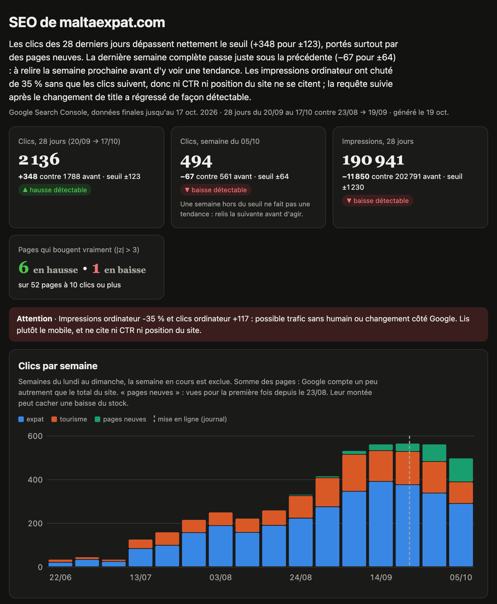

# search-console : ton compte rendu SEO, sans inventer de signal

Une skill Claude Code qui lit ta Search Console, calcule ce qui a vraiment bougé et ce qui n'est que
du bruit, et te rend un tableau de bord d'une page avec un calendrier de relecture. La semaine
suivante, « rafraîchis le dashboard » suffit.



*Le tableau de bord sur maltaexpat.com, mon site pour les expats à Malte, le 19 octobre 2026.*

## Ce que tu obtiens

- les quatre chiffres du moment (28 jours contre 28 jours, dernière semaine contre la précédente),
  chacun avec son écart, son seuil et son verdict : détectable ou non détectable ;
- les clics par semaine, par groupe de pages ;
- les pages qui bougent vraiment, et celles qui ne font que du bruit ;
- le test « demande ou classement » : tes impressions baissent parce que les gens cherchent moins,
  ou parce que Google te classe moins bien ?
- le suivi de tes changements (un titre réécrit, une page déplacée) : amélioré, pas de régression,
  régression, ou indécidable ;
- l'indexation page par page, et les requêtes servies par plusieurs de tes pages ;
- un calendrier : quoi relire, et quand.

Une page HTML autonome : elle s'ouvre hors ligne, se lit sur téléphone, et se publie en Artifact
sur claude.ai.

## Installation

Dans Claude Code :

```
/plugin marketplace add vincentventalon/my-claude-skills
/plugin install search-console@my-claude-skills
```

Ou à la main : copie le dossier `search-console/skills/search-console` de ce repo dans `~/.claude/skills/`
(pour tous tes projets) ou dans `.claude/skills/` d'un projet.

Il faut Python 3 (rien d'autre à installer côté Python).

## Prérequis Google (une fois, dix minutes)

1. Une propriété Search Console de type **Domaine** (`sc-domain:monsite.com`).
2. Le [Google Cloud CLI](https://cloud.google.com/sdk/docs/install) et un projet Google Cloud avec
   l'API Search Console activée :
   ```
   gcloud services enable searchconsole.googleapis.com --project mon-projet
   ```
3. La connexion, avec le compte qui voit ton site dans Search Console :
   ```
   gcloud auth application-default login --scopes=https://www.googleapis.com/auth/cloud-platform,https://www.googleapis.com/auth/webmasters.readonly
   ```
4. Le piège : chaque appel doit porter l'en-tête `X-Goog-User-Project`, sinon Google répond
   403 « requires a quota project ». Donne l'id de ton projet une fois :
   ```
   gcloud auth application-default set-quota-project mon-projet
   ```
   (ou `export GSC_QUOTA_PROJECT=mon-projet`, ou `./seo/config.json` avec
   `{"projet_google_cloud": "mon-projet"}`).

Lecture seule : la skill ne modifie rien dans ta Search Console.

## Les phrases à dire

- « fais-moi un compte rendu SEO de monsite.com »
- « rafraîchis le dashboard »
- « est-ce que mon changement de titre a marché ? »
- « pourquoi mes clics ont baissé ? »
- « mes pages sont-elles indexées ? »

Tes données restent chez toi, dans `./seo/` du dossier où tu lances Claude : le journal des
changements, les groupes de pages, les données téléchargées et le tableau de bord. Seul
`~/.config/search-console/dossiers.txt` retient le dernier `./seo/` utilisé, pour que « rafraîchis
le dashboard » marche depuis n'importe quel dossier.

Chaque compte rendu commence par un résumé de deux ou trois phrases écrit par Claude à partir des
chiffres du script. Il est réécrit à chaque rafraîchissement.

Pas de terminal ? Sur claude.ai, dépose l'export CSV du rapport Performances (mode Comparer,
28 jours). La skill fait la même analyse et te dit ce qui manque.

## Pannes courantes

| message | remède |
|---|---|
| `Pas de jeton d'accès Google` | relance la commande de connexion (étape 3) |
| `requires a quota project` / `Pas de projet Google Cloud pour le quota` | étape 4 |
| `l'API Google Search Console n'est pas activée` | `gcloud services enable searchconsole.googleapis.com --project mon-projet` |
| `scope manquant` | reconnecte-toi avec les deux scopes de l'étape 3 |
| `Propriété introuvable` | le script liste les propriétés que ton compte voit : vérifie le compte, ou crée la propriété Domaine |
| `Le projet … n'existe pas` | donne l'id du projet, pas son nom : `gcloud projects list` |

Le détail : [references/installation.md](references/installation.md).
